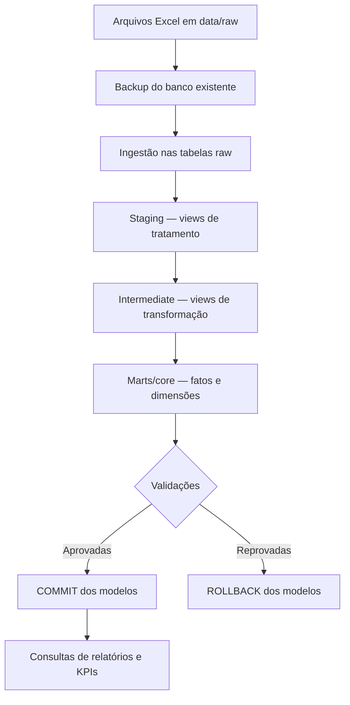

# Pipeline Local de Dados — Academia

Pipeline de dados local para uma academia desenvolvido com Python, SQL e SQLite. O projeto transforma arquivos Excel em um modelo dimensional preparado para consultas, indicadores e relatórios.

Os dados são fictícios e simulam exportações de sistemas de gestão de academia.

## Objetivo

Automatizar a atualização de um data warehouse local, desde a ingestão dos arquivos até a disponibilização dos dados para análise.

O projeto contempla:

- Ingestão de planilhas Excel.
- Limpeza e padronização com SQL.
- Transformações e agregações em camadas.
- Modelagem dimensional com fatos e dimensões.
- Validações antes da confirmação das transformações.
- Backup do recorte mais recente do banco de dados.
- Log e resumo da execução do pipeline.
- Execução do pipeline agendada.

## Tecnologias


## Fluxo dos dados



## Fontes

| Fonte | Conteúdo |
|---|---|
| Alunos | Cadastro e informações dos alunos |
| Planos | Tipos de planos, duração e valores |
| Matrículas | Contratações e períodos de vigência |
| Pagamentos | Cobranças, valores pagos e datas |
| Presenças | Registros de entrada e atividades |

A ingestão utiliza carga completa: o conteúdo das tabelas raw é substituído pelos dados das planilhas.

**Os arquivos de entrada devem conter a exportação completa e atualizada de cada tabela.**

## Organização das camadas

### Raw

Preserva os valores recebidos dos arquivos Excel.

### Staging

Views que padronizam os campos da origem. Os tratamentos incluem:

- Remoção de espaços nas extremidades dos nomes.
- Padronização de e-mails.
- Remoção da formatação de telefones.
- Conversão de datas numéricas do Excel para `AAAA-MM-DD`.
- Conversão de horários fracionários para `HH:MM`.
- Arredondamento de valores monetários.

### Intermediate

Views que aplicam junções e cálculos reutilizáveis:

| Modelo | Finalidade |
|---|---|
| `int_matriculas_detalhadas` | Relacionar matrículas, alunos e planos |
| `int_alunos_frequencia` | Calcular indicadores atuais de frequência por aluno |
| `int_alunos_frequencia_mensal` | Agregar os dias frequentados por aluno e mês |

### Marts/core

Tabelas físicas destinadas ao consumo analítico:

| Tabela | Granularidade |
|---|---|
| `dim_aluno` | Uma linha por aluno |
| `dim_plano` | Uma linha por plano |
| `dim_data` | Uma linha por dia |
| `fato_matricula` | Uma linha por matrícula |
| `fato_pagamentos` | Uma linha por registro de pagamento ou cobrança |
| `fato_presenca` | Uma linha por entrada |
| `fato_frequencia_mensal` | Uma linha por aluno e mês |

A `dim_aluno` também reúne indicadores atuais, como última presença e frequência nos últimos 30 dias. Esses valores são atualizados a cada carga.

### Marts/reports

Views com consultas prontas para análise, incluindo:

- Recebimentos mensais do ano atual.
- Frequência média mensal.
- Total de presenças no mês atual.


## Execução local

### 1. Preparar o ambiente

**Programas necessários:**

- Python 3.10 ou superior.
- Git, para clonar o repositório.
- Windows, para utilizar o arquivo `.bat` e o Agendador de Tarefas.
- DB Browser for SQLite (opcional), para consultar o banco visualmente.

**Bibliotecas Python necessárias:**

- `pandas`
- `openpyxl`


### 2. Preparar as fontes e estruturas

- Coloque as planilhas completas em `data/raw`.
- Preserve os nomes dos arquivos e das colunas esperados pela ingestão.
- Na primeira configuração, execute os SQLs de `db/schemas` para criar as tabelas finais.
- Preencha a `dim_data` com um intervalo que cubra as datas necessárias.
- Confira os caminhos definidos em `src/config.py`.


### 3. Executar o pipeline

Na raiz do projeto:

```powershell
python src/orchestrator.py
```

Para executar pelo arquivo Batch e registrar a saída no log:

```powershell
.\run_pipeline.bat
```

O `.bat` deve utilizar o Python do ambiente onde as dependências foram instaladas.

## Validações

As regras ficam em SQL, enquanto `validations.py` executa as consultas e interpreta a coluna `quantidade_erros`.

| Validação | Verificação |
|---|---|
| Quantidades | Compara contagens das fontes com os destinos |
| Total de pagamentos | Compara a soma de `valor_pago` entre staging e fato |

Zero indica aprovação. Uma reprovação interrompe o pipeline.

As validações são executadas na mesma conexão dos modelos, antes do `COMMIT`. Se houver falha, as alterações dessa etapa são desfeitas.

**A ingestão é confirmada separadamente e não é desfeita pelo rollback dos modelos.** As verificações também não garantem a correção de todos os valores recebidos na origem.

## Backup

- Os arquivos são salvos em `db/backups`.
- Apenas os dois backups mais recentes são mantidos.
- A restauração é manual.

## Logs e resumo

O `run_pipeline.bat` registra as mensagens e os erros em:

```text
logs/ultima_execucao.log
```

O resumo apresenta:

- Quantidade de registros nas tabelas raw.
- Quantidade de registros nas dimensões e fatos.
- Duração da carga.

## Agendamento

A execução diária é configurada no Agendador de Tarefas do Windows, que chama `run_pipeline.bat`.

Antes de executar, finalize transações pendentes em ferramentas como DB Browser for SQLite para evitar bloqueios de escrita.

## Próximas melhorias

- Exportação automática dos relatórios para Excel.
- Processamento em banco temporário antes da publicação no banco oficial.